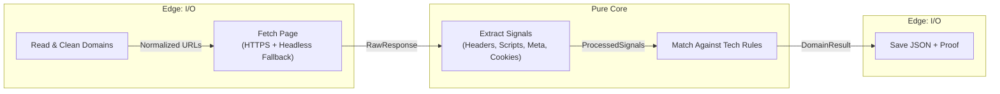

# Website Technologies Scraper — Design Document

## Stage 1: Scope, Inputs, Outputs & Non-Goals

### 1. Goal
Given a domain, detect every web technology it uses (CMS, analytics, JS frameworks, CDNs) and provide the exact code, header, or cookie clue ("proof") that confirms each detection.

### 2. Input & Edge Cases
* **Input:** A file containing 200 domain names.
* **Edge Cases to Handle:**
  * Missing `https://` prefixes
  * Unreachable or dead domains
  * Request timeouts
  * `403 Forbidden` bot blocks
  * HTTP redirects (`301` / `302`)
  * Client-side rendered JavaScript apps (SPAs)

### 3. Output
* **`output/results.json`:** Lists each domain, its crawl status (`OK` or `ERROR`), and every detected technology paired with its proof (e.g., `Shopify` $\rightarrow$ matched header `x-shopid` or script `cdn.shopify.com`).
* **`README.md`:** Summary statistics (targeting close to the 477-technology benchmark) and engineering answers to the 3 scaling and discovery debate questions.

### 4. Constraints & Non-Goals (v1)
* **No Web UI / Frontend Dashboard:** CLI execution and JSON output only.
* **No Multi-Server Distributed Crawling:** A single machine with async workers is sufficient for 200 domains.
* **No Automated ML Discovery of Unknown Tech:** Covered conceptually in `README.md` rather than implemented in v1.

---

## Stage 2: High-Level Architecture & Data Flow




## Stage 3: Data Schemas

These data structures act as strict contracts between the pipeline stages in Stage 2:

```python
from dataclasses import dataclass, field

# Arrow 2: Output of Fetcher -> Input to Extractor
@dataclass
class RawResponse:
    domain: str
    final_url: str
    status_code: int | None = None
    headers: dict[str, str] = field(default_factory=dict)
    cookies: dict[str, str] = field(default_factory=dict)
    html: str = ""
    fetch_method: str = "http"  # "http" or "headless"
    error: str | None = None    # Populated if DNS, timeout, or SSL fails

# Arrow 3: Output of Extractor -> Input to Rule Matcher
@dataclass
class ProcessedResponse:
    domain: str
    headers: dict[str, str]      # Lowercased header keys/values
    cookies: dict[str, str]      # Cookie names and values
    script_srcs: list[str]       # All <script src="..."> URLs
    meta_tags: dict[str, list[str]]    # Lowercased meta name -> list of content
    html: str                    # Raw HTML for body/pattern checks

# Arrow 4: Output of Rule Matcher -> Input to Exporter (saved to results.json)
@dataclass
class Proof:
    source: str                  # e.g., "header", "script_src", "cookie", "meta", "html"
    matched_value: str           # Exact snippet found on the page
    pattern: str                 # Regex rule that triggered the match
    key: str | None = None       # Header or meta tag name (if applicable)

@dataclass
class DetectedTech:
    name: str
    categories: list[str]
    proofs: list[Proof]

@dataclass
class DomainResult:
    domain: str
    status: str                  # "OK" or "ERROR"
    technologies: list[DetectedTech] = field(default_factory=list)
    error: str | None = None